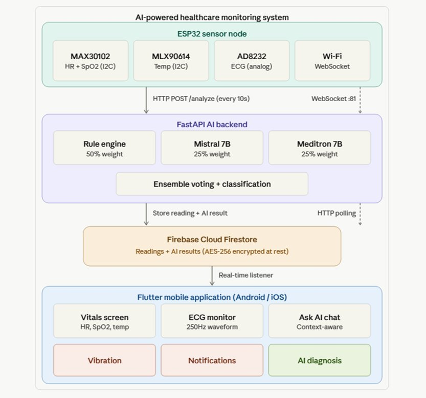

# AI-Powered Healthcare Monitoring System

A real-time health monitoring system that combines IoT sensors, AI-driven analysis, and a mobile application to continuously track vital signs and provide intelligent health assessments.



## Overview

This system was developed as a senior capstone project (CPEG-ELEG-SEG 480) at the American University of Kuwait. It monitors heart rate, blood oxygen saturation (SpO2), body temperature, and ECG signals using an ESP32-based sensor node, processes the data through an AI backend with ensemble classification, and displays results on a Flutter mobile app with real-time alerts.

## System Architecture

| Layer | Technology | Description |
|-------|-----------|-------------|
| **Sensor Node** | ESP32 DevKit V1 | Reads MAX30102 (HR/SpO2), MLX90614 (temperature), AD8232 (ECG) |
| **AI Backend** | FastAPI + Ollama | Ensemble voting: Rule engine (50%) + Mistral 7B (25%) + Meditron 7B (25%) |
| **Database** | Firebase Cloud Firestore | Stores readings and AI results (AES-256 encrypted at rest) |
| **Mobile App** | Flutter (Android/iOS) | Real-time vitals, ECG waveform, AI chat, vibration alerts |

## Features

- **Real-time vital sign monitoring** — HR, SpO2, and contactless body temperature updated every 10 seconds
- **Live ECG waveform** — 250Hz streaming via WebSocket with real-time chart display
- **AI health classification** — Three-tier alerts: NORMAL, WARNING, CRITICAL
- **Ensemble AI analysis** — Combines rule-based logic with two medical LLMs for accurate classification
- **Smart alerts** — Vibration patterns for different severity levels
- **AI chat assistant** — Context-aware medical Q&A using current vitals

## Project Structure

```
healthcare-ai/
├── main_maximum_accuracy.py          # FastAPI AI backend server
├── main_maximum_accuracy_clean.py    # Clean version (no comments)
├── esp32_code/
│   └── esp32_code.ino                # Arduino code for ESP32 sensor node
├── health_monitor/                   # Flutter mobile application
│   └── lib/
│       └── main.dart                 # Main app code
├── clean_appendix/                   # Clean versions for report appendix
│   ├── main_clean (1).dart
│   ├── main_maximum_accuracy_clean.py
│   └── esp32_code.ino
├── docs/
│   └── system_architecture.png       # System architecture flowchart
└── README.md
```

## Hardware Components

| Component | Function | Interface |
|-----------|----------|-----------|
| ESP32 DevKit V1 (30-pin) | Microcontroller | Wi-Fi |
| MAX30102 | Heart rate + SpO2 | I2C Fast 400kHz (GPIO 21/22) |
| MLX90614 | Contactless temperature | I2C Standard 100kHz (GPIO 21/22) |
| AD8232 | ECG sensor | Analog GPIO 32, leads detection GPIO 34/35 |

## Setup

### Backend

```bash
# Install dependencies
pip install fastapi uvicorn firebase-admin requests

# Install Ollama and pull models
ollama pull mistral
ollama pull meditron

# Run the server
python main_maximum_accuracy.py
```

The backend runs on port 8000 with endpoints:
- `POST /analyze` — Analyze sensor readings
- `GET /user/{userId}/latest` — Get latest results
- `POST /chat` — AI chat with health context

### ESP32

1. Open `esp32_code/esp32_code.ino` in Arduino IDE
2. Install required libraries: Wire, WiFi, WebSocketsServer, MAX30105, MLX90614
3. Update Wi-Fi credentials and backend IP address
4. Upload to ESP32 DevKit V1

### Mobile App

```bash
cd health_monitor
flutter pub get
flutter run
```

Update the backend URL and ESP32 WebSocket IP in `lib/main.dart` before running.

## Known Limitations

- ESP32 IP address changes on reboot (check Serial Monitor at 115200 baud)
- Heart rate takes ~30 seconds to stabilize due to shared I2C bus
- SpO2 is estimated from IR intensity, not clinically calibrated
- ECG tested with test signals only (not clinical electrodes)
- Original LILYGO T-Watch design was pivoted to breadboard prototype

## API Response Format

```json
{
  "status": "NORMAL | WARNING | CRITICAL",
  "reason": "Explanation of the classification",
  "recommendations": ["List of health recommendations"],
  "possible_causes": ["Potential causes if abnormal"],
  "seek_care": "Guidance on when to seek medical attention"
}
```

## Tech Stack

- **Embedded:** C++ (Arduino), ESP32 Core v3.3.8
- **Backend:** Python, FastAPI, Ollama, Firebase Admin SDK
- **AI Models:** Mistral 7B, Meditron 7B
- **Mobile:** Dart, Flutter, Firebase Firestore
- **Database:** Firebase Cloud Firestore

## Team

| Name | Role |
|------|------|
| Ali | Developer |
| Hussain | Developer |
| Rabih | Developer |
| Dr. Seyed Esmaeili | Supervisor |

**American University of Kuwait — Senior Capstone Project (2024-2025)**

## License

This project was developed for academic purposes as part of a university capstone course.
